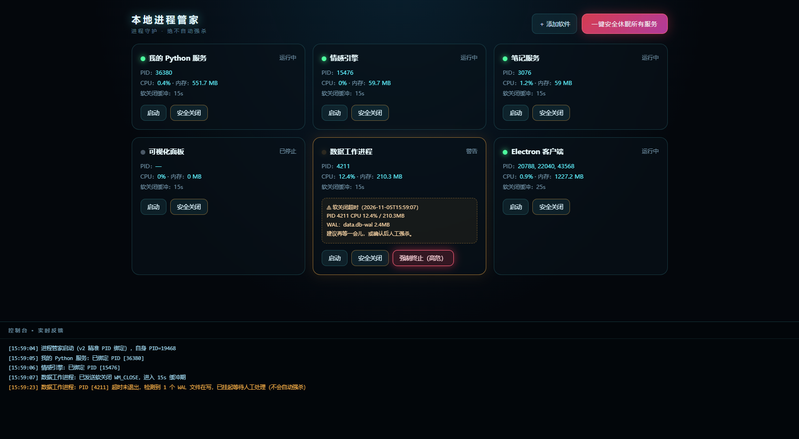

# Local Process Manager

Windows 下跑多个 Python 微服务 / Electron 客户端时，任务管理器强杀常导致 SQLite 死锁和显存泄漏。本工具提供了一个带 Web UI 的控制台，支持优雅关闭、超时预警与用户终审。

## 环境与适用性

**✅ 极佳适配**

- **Windows 10 / 11**
- 本地同时运行多个 **Python 微服务或 MCP Server** 的架构
- 包含 **Electron 等基于 Chromium 的 GUI 客户端**
- 服务涉及**本地数据库读写（如 SQLite）**或**占用显卡显存（如 CUDA / Torch）**——这类进程被强杀时极易数据损坏或显存泄漏

**❌ 不支持 / 不适用**

- **Linux / macOS** 等非 Windows 系统（本工具深度依赖 Win32 API）
- 基于 **Docker 容器**部署的服务（Docker 自带优雅停机机制，无需额外接管）
- **无状态、单进程的简单脚本**（直接关闭即可）



## 特性

- **WM_CLOSE 优雅关闭**：先让 GUI / Electron 程序自己保存退出，控制台窗口不误发
- **用户终审**：超时只挂起警告，只有你点红色按钮并二次确认才会 kill
- **防自杀 PID**：管家自身 PID 永不参与匹配和强杀
- **本地 Web UI**：127.0.0.1，无外联，状态灯和日志实时刷新
- **自定义服务**：配置文件或网页里加，命令只在本地 JSON 里

## 快速开始

```bash
pip install -r requirements.txt
copy manager_config.example.json manager_config.json
python manager_server.py
```

浏览器打开 `http://127.0.0.1:8791`。Windows 也可以直接双击 `launcher.vbs`。

## 配置

```json
{
  "services": [{
    "id": "my-app",
    "name": "My App",
    "keywords": ["my_app.py"],
    "start_cmd": "pythonw.exe C:\\YourPath\\App\\my_app.py",
    "work_dir": "C:\\YourPath\\App",
    "graceful_timeout": 15
  }]
}
```

## 说明

- 只监听 `127.0.0.1`，没有鉴权，别暴露到公网
- `WM_CLOSE` 仅 Windows 有效；其它平台退化为 `terminate()`
- 不能防物理断电，重要数据请自行备份

MIT License
